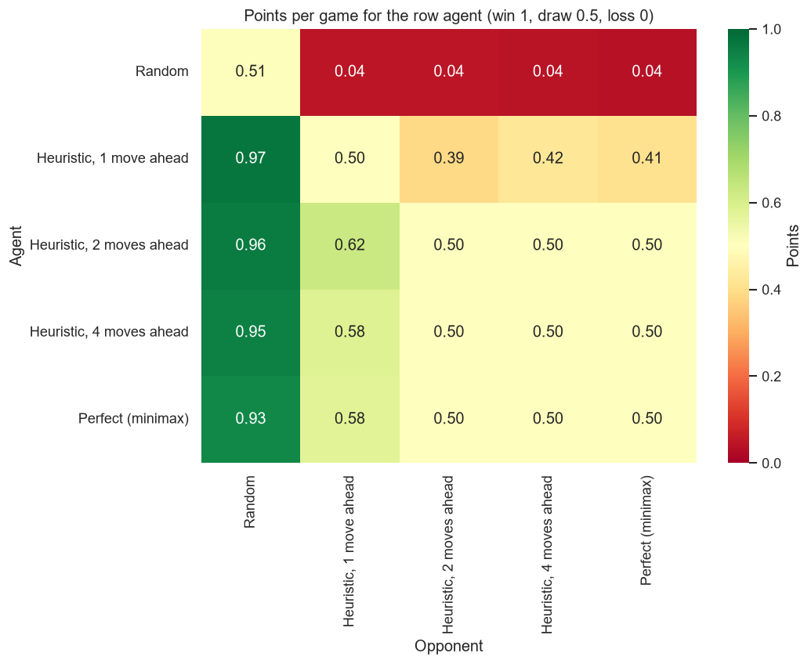

<div align="center">

<h1>Tic-tac-toe agent</h1>

<p>A tic-tac-toe agent that picks its moves by searching the game tree: plain minimax, minimax with alpha-beta pruning, and a depth-limited search that scores unfinished boards with a heuristic. A tournament pits every agent against every other, and an interactive demo lets you play them and see how they valued each move.</p>

<p>
<a href="https://github.com/pxnz3r/tictactoe-agent/actions/workflows/ci.yml"></a>

<a href="LICENSE"></a>
</p>

<p><a href="docs/results.md">Results</a> · <a href="docs/methodology.md">Methodology</a> · <a href="docs/deploy.md">Deploy the demo</a></p>



</div>

## How it works

1. **Count the game tree**: every possible game of tic-tac-toe.
2. **Search it** with plain minimax, alpha-beta pruning and a depth-limited heuristic search, and measure the effort.
3. **Play a tournament**: every agent against every agent, 100 games as X and 100 as O, with 95% intervals on the loss rate.
4. **Play against any agent** in the Streamlit demo and see the value it gives every empty cell.

## Results

| Question | Finding |
| --- | --- |
| How big is the game tree? | 549,946 boards from the empty board, 255,168 complete games, 5,478 distinct boards. Perfect play from both sides is a draw. |
| What does alpha-beta save? | The same first-move value from 20,866 boards instead of 549,946 (26x fewer), and 7,865 (70x fewer) when it tries the centre and corners first. |
| How far must a heuristic agent look? | 2 moves ahead never lost a game, even to perfect play. 1 move ahead lost 37 of 200 games to it. |
| Is perfect play the best play? | Not against weak players. Minimax won 86% against the random agent, the 1-move heuristic 96%. Minimax treats every move that keeps the draw as equal; the heuristic prefers boards with more open lines, which sets more traps. |

**Boards visited to value the empty board:**

| Search | Boards visited | Milliseconds |
| --- | --- | --- |
| Minimax (full tree) | 549,946 | 2,316 |
| Alpha-beta | 20,866 | 110 |
| Alpha-beta, centre and corners first | 7,865 | 40 |
| Heuristic, 2 moves ahead | 82 | 0.7 |
| Heuristic, 4 moves ahead | 3,610 | 30 |

Full tables and figures: [docs/results.md](docs/results.md). How it was done: [docs/methodology.md](docs/methodology.md).

## How sure the results are

**The perfect agent never loses.** 0 losses in 200 games against every opponent. With a 95% Wilson interval, its true loss rate is below 1.9%.

**Looking two moves ahead is enough to hold a draw.** The 2- and 4-move heuristic agents drew all 200 games against minimax; the 1-move agent lost 13.7% to 24.5% of the time.

Every table and figure behind these is in [docs/results.md](docs/results.md).

## Run it

Needs Python 3.14+ and [uv](https://docs.astral.sh/uv/).

```bash
uv sync
uv run python main.py
uv run streamlit run app.py
```

`main.py` counts the game tree, measures each search and runs the tournament, writing figures and tables to `outputs/` and `docs/results.md`. The demo plays live and needs `main.py`'s output only for the Search effort and Results tabs.

## The demo

- **Overview**: the agents and what was found.
- **Play**: play X or O against any agent. After each reply, a grid shows the value the agent gave every empty cell.
- **Search effort**: boards visited by each search.
- **Results**: the tree size, search effort and tournament tables.

## Layout

```
tictactoe_agent/   game.py (board and rules), agents.py (minimax, alpha-beta, heuristic search), report.py
pxlab/             shared engine (vendored): app and output helpers
main.py            the full study
app.py             the Streamlit demo
docs/              methodology, results, deploy
```

## License

MIT.
