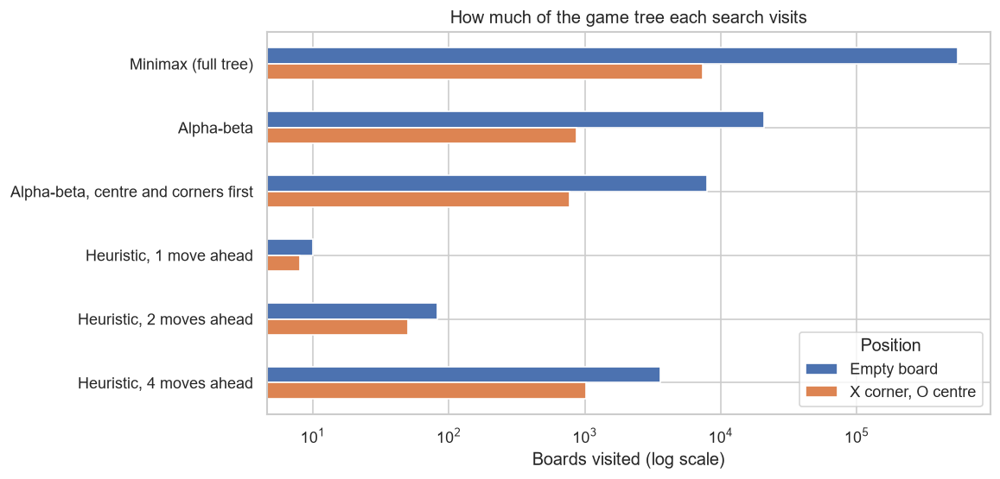
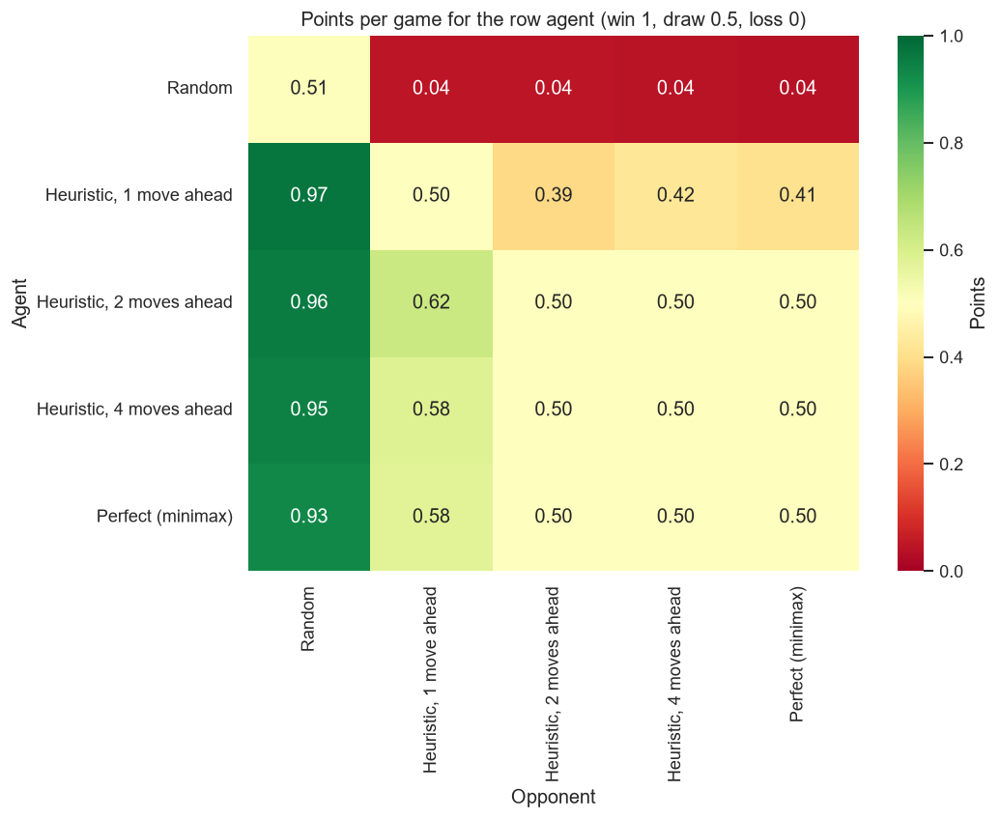

# Results

Produced by `python main.py`. Counts don't depend on the machine; times are from one run in plain Python. Tournament ties between equally good moves are broken at random with seed 42.

## Game tree

### Size of the tic-tac-toe game tree

|  | Count |
| --- | --- |
| Boards in the full game tree (with repeats) | 549946 |
| Complete games | 255168 |
| Distinct boards | 5478 |
| Value of the empty board with perfect play | 0 |

## Search effort

### Boards visited to value a position

| Position | Search | Boards visited | Milliseconds | Value |
| --- | --- | --- | --- | --- |
| Empty board | Minimax (full tree) | 549946 | 2316.1 | 0 |
| Empty board | Alpha-beta | 20866 | 110.2 | 0 |
| Empty board | Alpha-beta, centre and corners first | 7865 | 40.3 | 0 |
| Empty board | Heuristic, 1 move ahead | 10 | 0.1 | 4 |
| Empty board | Heuristic, 2 moves ahead | 82 | 0.7 | 1 |
| Empty board | Heuristic, 4 moves ahead | 3610 | 29.8 | 0 |
| X corner, O centre | Minimax (full tree) | 7332 | 34.3 | 0 |
| X corner, O centre | Alpha-beta | 871 | 2.8 | 0 |
| X corner, O centre | Alpha-beta, centre and corners first | 768 | 4.8 | 0 |
| X corner, O centre | Heuristic, 1 move ahead | 8 | 0.1 | 10 |
| X corner, O centre | Heuristic, 2 moves ahead | 50 | 0.5 | -9 |
| X corner, O centre | Heuristic, 4 moves ahead | 1020 | 7.3 | -8 |

## Tournament

### 200 games per pairing, results for the first-named agent

| Agent | Opponent | Wins | Draws | Losses |
| --- | --- | --- | --- | --- |
| Random | Random | 86 | 31 | 83 |
| Random | Heuristic, 1 move ahead | 4 | 10 | 186 |
| Random | Heuristic, 2 moves ahead | 0 | 18 | 182 |
| Random | Heuristic, 4 moves ahead | 0 | 17 | 183 |
| Random | Perfect (minimax) | 0 | 15 | 185 |
| Heuristic, 1 move ahead | Random | 192 | 4 | 4 |
| Heuristic, 1 move ahead | Heuristic, 1 move ahead | 0 | 200 | 0 |
| Heuristic, 1 move ahead | Heuristic, 2 moves ahead | 0 | 156 | 44 |
| Heuristic, 1 move ahead | Heuristic, 4 moves ahead | 0 | 169 | 31 |
| Heuristic, 1 move ahead | Perfect (minimax) | 0 | 163 | 37 |
| Heuristic, 2 moves ahead | Random | 184 | 16 | 0 |
| Heuristic, 2 moves ahead | Heuristic, 1 move ahead | 50 | 150 | 0 |
| Heuristic, 2 moves ahead | Heuristic, 2 moves ahead | 0 | 200 | 0 |
| Heuristic, 2 moves ahead | Heuristic, 4 moves ahead | 0 | 200 | 0 |
| Heuristic, 2 moves ahead | Perfect (minimax) | 0 | 200 | 0 |
| Heuristic, 4 moves ahead | Random | 179 | 21 | 0 |
| Heuristic, 4 moves ahead | Heuristic, 1 move ahead | 33 | 167 | 0 |
| Heuristic, 4 moves ahead | Heuristic, 2 moves ahead | 0 | 200 | 0 |
| Heuristic, 4 moves ahead | Heuristic, 4 moves ahead | 0 | 200 | 0 |
| Heuristic, 4 moves ahead | Perfect (minimax) | 0 | 200 | 0 |
| Perfect (minimax) | Random | 172 | 28 | 0 |
| Perfect (minimax) | Heuristic, 1 move ahead | 31 | 169 | 0 |
| Perfect (minimax) | Heuristic, 2 moves ahead | 0 | 200 | 0 |
| Perfect (minimax) | Heuristic, 4 moves ahead | 0 | 200 | 0 |
| Perfect (minimax) | Perfect (minimax) | 0 | 200 | 0 |
